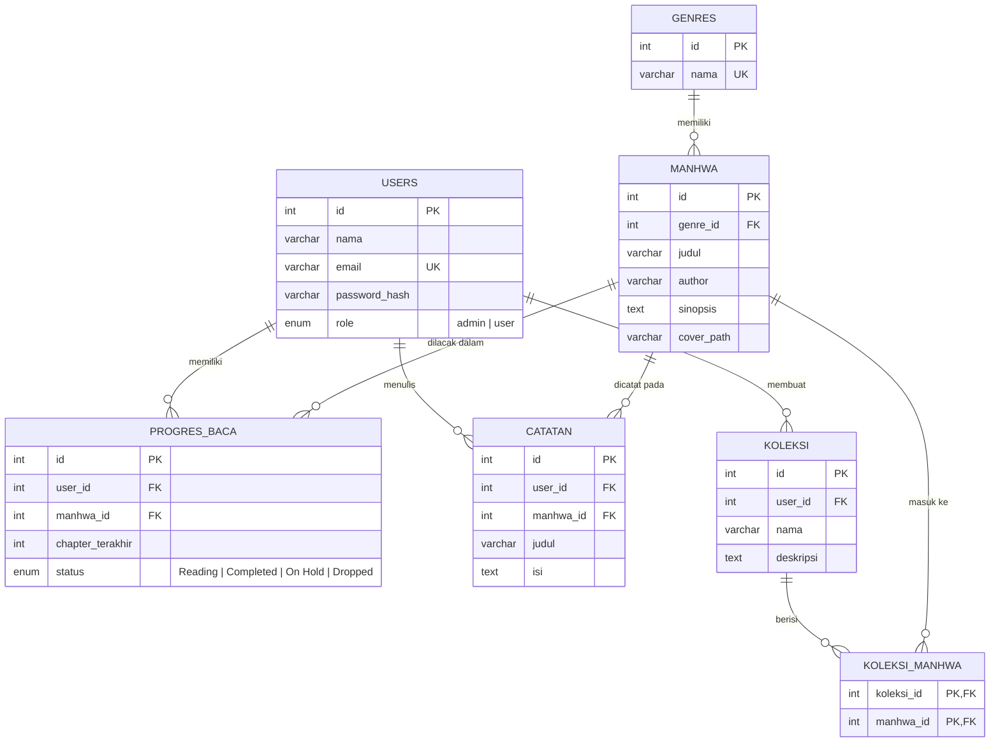

# ERD FourthWall

6 entitas utama dan 1 tabel penghubung, sesuai `backend/database/schema.sql`.

## Aturan Penting

| Aturan | Implementasi |
|---|---|
| Satu manhwa punya satu genre utama | `manhwa.genre_id` wajib diisi |
| Genre yang masih dipakai tidak bisa dihapus | `ON DELETE RESTRICT` |
| Satu user hanya punya satu progres per manhwa | `UNIQUE (user_id, manhwa_id)` |
| Koleksi dan manhwa many-to-many | Tabel `koleksi_manhwa` dengan primary key gabungan |
| Data pribadi punya pemilik | `user_id` pada progres, catatan, dan koleksi |
| Password tidak disimpan polos | `password_hash` (bcrypt) |